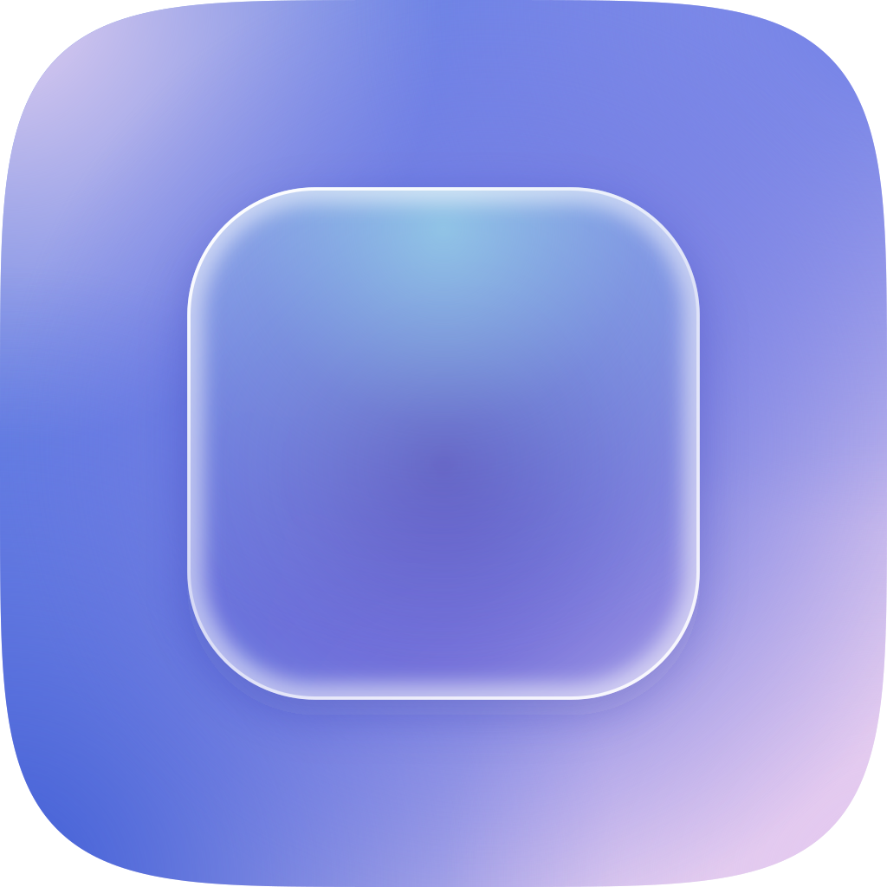

  

<h1 align="center">Blinders</h1>

<strong>Share your screen, not your secrets.</strong>

Blinders is a macOS menu bar app that blurs or covers parts of your screen. Hide chats, tabs and customer data before you share your screen, or hide distractions while you watch something.

**Website and download: [zrna.github.io/blinders](https://zrna.github.io/blinders)**

[Download Blinders for Mac (.dmg)](https://zrna.github.io/blinders/download/Blinders.dmg) · macOS 15 or later · Apple Silicon and Intel · signed and notarized by Apple

## What it does

- **Privacy while screen sharing**: cover chats and notifications, your inbox, other browser tabs, customer data, or API keys in a terminal before anyone sees them.
- **Focus**: blur everything except the video or talk you're watching, or hide just the distracting sidebar.
- **Blur or solid color**: a live blur that keeps up with moving video, or a solid color for things that must stay unreadable.
- **Attached to windows and tabs**: a cover moves and scales with its window, and every window and browser tab can have its own.
- **Stays out of your way**: clicks and typing pass straight through, the Dock and menu bar stay sharp, and browser tab strips stay clickable.
- **Your controls stay private**: the toolbar, frames and buttons are excluded from screenshots and screen sharing. Viewers only see the effect.

## Getting started

1. Download the .dmg, open it and drag Blinders to Applications.
2. Open Blinders. It lives in the menu bar.
3. Press **⇧⌘F**, drag an area (or press **Space** and click a whole window), then press **Enter**.

| Action | Shortcut |
|---|---|
| Select or edit areas | ⇧⌘F |
| Switch between area and window tool | Space |
| Cycle through areas | Tab / ⇧Tab |
| Remove the selected area | Delete, or its ✕ |
| Apply | Enter |
| Cancel | Esc |
| Peek behind the cover | ⇧⌘C (tap to toggle, hold to look) |

Both global shortcuts can be changed in Settings.

**Share your entire screen** (or a display), not a single window or tab. Apps that share one window capture its content without the cover.

## Privacy

Blur needs the *Screen & System Audio Recording* permission, because Blinders has to see what's underneath the area it blurs. Frames are processed locally, in memory, and are never stored or sent anywhere. The solid color style works without any permission. Blinders doesn't need Accessibility access and has no analytics.

---

This repository holds the source of the Blinders website.
